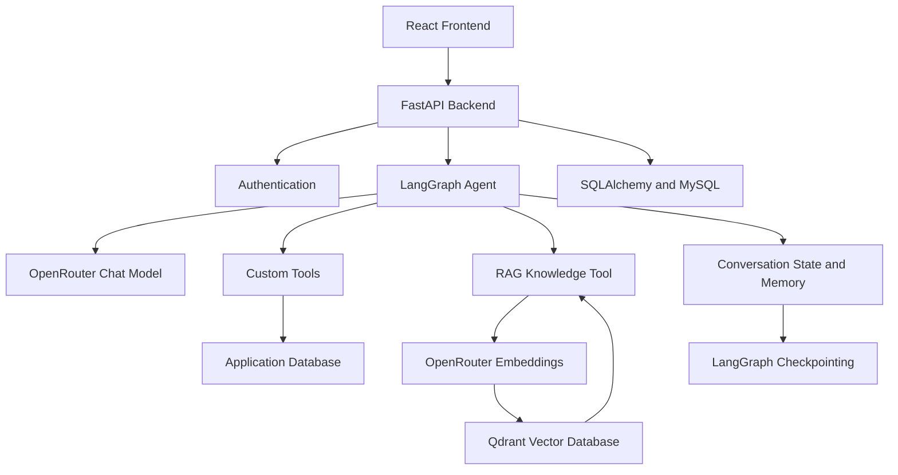

# Agent-v2 🤖

### An AI-Powered Customer Support Agent Built with FastAPI, LangGraph, and RAG

Agent-v2 is an AI customer-support assistant developed as part of my journey into agentic AI engineering. It combines large language models, custom tools, database access, conversational context, and Retrieval-Augmented Generation (RAG) to answer questions and retrieve relevant information.

The project focuses on building a practical AI application with a modular backend architecture, rather than just a basic chatbot.

> **Project status:** In active development.

## ✨ Features

- **AI Agent:** Uses LangChain and LangGraph to orchestrate model responses and tool calls.
- **Custom Tools:** Enables the agent to access application-specific functionality and retrieve information.
- **Retrieval-Augmented Generation (RAG):** Retrieves relevant company documentation from a vector database before answering knowledge-based questions.
- **Semantic Search:** Uses embeddings and Qdrant to search documents by meaning rather than relying exclusively on exact keyword matches.
- **Conversation Persistence:** Stores users, conversations, and messages using a relational database.
- **Authentication:** Provides authenticated API access for users.
- **Streaming Responses:** Supports sending generated model tokens to the frontend using Server-Sent Events (SSE).
- **Conversation Context:** Uses LangGraph checkpointing, state management, and summarization middleware to help manage conversational history.
- **Modular Architecture:** Separates API routes, AI tools, agent logic, database models, and the RAG pipeline.

## 🛠️ Tech Stack

| Technology | Purpose |
|---|---|
| Python | Primary programming language |
| FastAPI | Backend API framework |
| LangChain | Models, tools, and agent integrations |
| LangGraph | Agent execution, state, and checkpointing |
| OpenRouter | Access to supported language and embedding models |
| Qdrant | Vector storage and semantic retrieval |
| SQLAlchemy | Database ORM and asynchronous database operations |
| Alembic | Database schema migrations |
| MySQL | Relational data storage |
| React | Frontend interface |
| Server-Sent Events | Streaming AI responses |

## 🏗️ Architecture



### How it works

1. A user sends a message through the frontend or API.
2. FastAPI handles the request and authenticates the user where required.
3. The LangGraph agent receives the message and decides whether it can answer directly or needs a tool.
4. Custom tools retrieve application data, while the knowledge-base tool searches company documentation through the RAG pipeline.
5. Retrieved information is returned to the agent as context.
6. The agent generates a response based on the available information.
7. The response is returned to the client, with streaming supported by the streaming endpoint.

## 🧠 Retrieval-Augmented Generation (RAG)

Agent-v2 includes a modular RAG pipeline for retrieving company-specific information.

### Pipeline

```text
Source Documents
      |
      v
Document Loaders
      |
      v
Text Splitting
      |
      v
Embedding Generation
      |
      v
Qdrant Vector Database
      |
      v
Query Embedding
      |
      v
Similarity Search
      |
      v
Retrieved Context
      |
      v
AI Agent
```

### Components

- **Document loaders:** Load text files and PDF documents into LangChain `Document` objects.
- **Text splitter:** Splits documents into smaller chunks while preserving useful Markdown heading metadata.
- **Embedding model:** Uses an OpenRouter embedding model to convert text into vectors.
- **Vector store:** Uses Qdrant to store document vectors and associated metadata.
- **Retriever:** Searches for relevant document chunks using semantic similarity.
- **Context builder:** Formats retrieved content and metadata for the agent.
- **Knowledge-base tool:** Exposes document retrieval as a tool the agent can call when it needs company-specific information.

The RAG pipeline is designed to be reusable, allowing additional company documentation to be indexed as the knowledge base grows.

## 🔧 AI Agent and Tools

The agent uses tool calling to access information and perform application-specific operations.

The tool layer is designed to support capabilities such as:

- Company information lookup
- User and order information retrieval
- Application-specific database operations
- Knowledge-base search through RAG
- Additional tools as the project evolves

LangGraph manages agent execution, while LangChain provides the tool and model integration layer.

### Conversation context

The project also explores managing longer conversations using:

- LangGraph checkpointing with `InMemorySaver`
- Shared application state and runtime context
- `InMemoryStore` for in-memory storage
- Message trimming
- Conversation summarization middleware

These components are part of the ongoing exploration of context management and memory in agentic AI systems.

## 📂 Project Structure

The project uses a modular backend structure. The main components include:

```text
Agent-v2/
├── backend/
│   └── app/
│       ├── ai/
│       │   ├── rag/
│       │   │   ├── loader/
│       │   │   ├── splitters/
│       │   │   ├── embeddings/
│       │   │   ├── vectorstores/
│       │   │   └── pipeline/
│       │   └── tools/
│       ├── api/
│       │   └── routes/
│       ├── models/
│       └── ...
├── frontend/
├── README.md
└── .env
```

*Note: This is a simplified overview. Some implementation files and directories are omitted.*

## 🚀 Getting Started

### Prerequisites

Before running the project, make sure you have:

- Python 3.13 or a compatible Python version
- Node.js and npm for the frontend
- A MySQL database
- An OpenRouter API key
- A Qdrant instance and API key

### 1. Clone the repository

```bash
git clone <YOUR_GITHUB_REPOSITORY_URL>
cd Agent-v2
```

### 2. Set up the Python environment

```bash
python3 -m venv .venv
source .venv/bin/activate
```

Install the project's Python dependencies using its dependency file, such as `requirements.txt` if present:

```bash
pip install -r requirements.txt
```

If dependencies are managed through another file or a package manager, use the corresponding installation command.

### 3. Configure environment variables

Create a `.env` file in the location expected by the backend configuration.

Example configuration:

```env
OPENROUTER_API_KEY=your_openrouter_api_key

QDRANT_API_KEY=your_qdrant_api_key
QDRANT_CLUSTER_ENDPOINT=your_qdrant_cluster_endpoint

DATABASE_URL=your_database_connection_string
```

Use the exact variable names expected by your configuration. Additional secrets or settings may be required by individual modules.

**Security:** Never commit real API keys, database credentials, JWT secrets, or other private environment variables to GitHub. Keep `.env` out of version control and provide a sanitized `.env.example` instead.

### 4. Set up the database

Configure the MySQL connection and run the project's Alembic migrations from the appropriate backend environment.

```bash
alembic upgrade head
```

Run this command from the directory where your Alembic configuration is available.

### 5. Start the backend

Activate the virtual environment and start the FastAPI application using the actual application module configured in your project.

For example, if the application entry point is `backend.app.main:app`:

```bash
uvicorn backend.app.main:app --reload
```

Open the FastAPI documentation at:

```text
http://127.0.0.1:8000/docs
```

### 6. Start the frontend

```bash
cd frontend
npm install
npm run dev
```

Use the local development URL printed by Vite and ensure that the frontend is configured to communicate with the backend.

## 🔌 API Overview

The backend includes chat-related endpoints such as:

| Method | Endpoint | Purpose |
|---|---|---|
| `POST` | `/chat/ai/chat` | Test an AI agent interaction |
| `POST` | `/chat/ai/stream` | Stream AI responses |
| — | `/chat` | Chat-related operations |
| — | `/chat/{conversation_id}` | Conversation-specific operations |

The exact request parameters, authentication requirements, and response formats are defined by the current API implementation. Check `/docs` for the authoritative endpoint specifications.

## 🗺️ Development Roadmap

- [x] FastAPI backend foundation
- [x] Database integration and migrations
- [x] User authentication
- [x] LangChain and LangGraph agent integration
- [x] Custom tool calling
- [x] Text and PDF document loaders
- [x] Document chunking and embedding generation
- [x] Qdrant-based semantic retrieval
- [x] RAG knowledge-base tool integration
- [x] Conversation and message persistence
- [x] Initial response streaming support
- [ ] Improve retrieval relevance and evaluation
- [ ] Add automated tests for the agent and RAG pipeline
- [ ] Improve conversation memory and long-term context management
- [ ] Add robust error handling, retries, and observability
- [ ] Improve deployment and production configuration
- [ ] Expand the agent's toolset and capabilities

*The roadmap reflects the current development direction; individual features may still need further testing or refinement.*

## 🎯 Project Goals

The goal of Agent-v2 is to explore the engineering behind useful AI assistants, including:

- Building tool-using AI agents
- Integrating LLMs into real backend applications
- Designing practical RAG pipelines
- Managing conversation state and memory
- Connecting AI systems to databases and APIs
- Developing modular, maintainable AI application architecture

This project is both a learning environment and a foundation for more capable AI applications.

## 👨‍💻 About

Built by **Aroku** while learning and developing practical applications in agentic AI engineering, backend development, and Retrieval-Augmented Generation.

The project is actively evolving as new concepts are implemented, tested, and integrated.

---

**Built with Python, FastAPI, LangGraph, LangChain, OpenRouter, and Qdrant.**